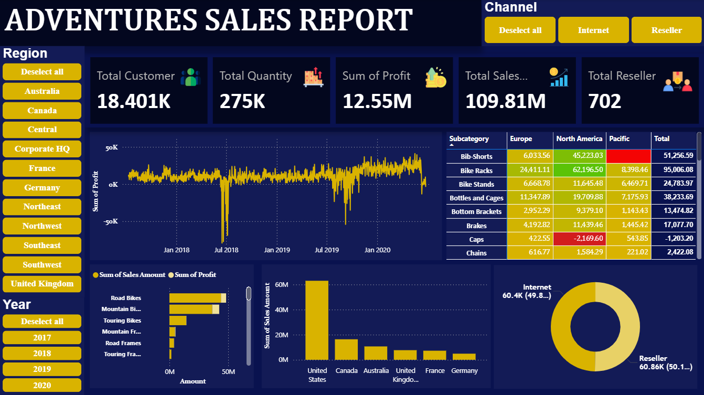
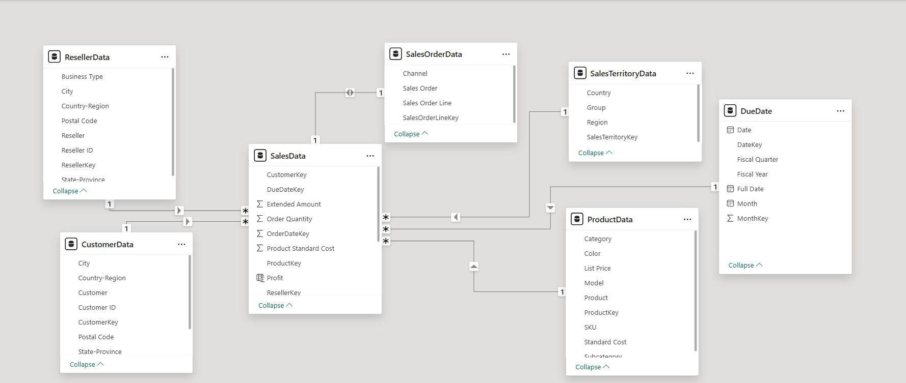

# Power BI AdventureWorks Sales Dashboard

An interactive Power BI Sales Analytics Dashboard built using the AdventureWorks sample sales dataset.

The dashboard provides an overview of sales performance, profit trends, product performance, sales channels, countries, customers, resellers, and order quantities from 2017 to 2021.

The project uses Power BI data modeling, relationships, DAX measures, interactive visualizations, and slicers to transform the raw AdventureWorks data into an interactive business intelligence dashboard.

## Project Overview

This project analyzes sales data related to:

- Accessories
- Customers
- Resellers
- Products
- Sales Territories
- Sales Orders

The dataset contains sales transactions from 2017 to 2021 across multiple countries and sales channels.

The dashboard contains a single interactive report page with KPI cards, charts, a heatmap, and slicers.

## Technologies Used

- Microsoft Power BI
- Power Query
- DAX
- Data Modeling
- Data Visualization
- Interactive Dashboards
- Slicers
- KPI Cards
- Heatmap
- Time-Series Analysis

## Dataset

The project uses the `AdventureWorks Sales.xlsx` sample dataset.

The dataset contains 7 related tables and covers sales transactions from 2017 to 2021.

## Data Model

### Sales Order Data

Table name:

`Sales Order_data`

Total rows:

`121,253`

Columns:

- Channel
- SalesOrderLineKey
- Sales Order
- Sales Order Line

The table contains sales order and sales channel information.

### Sales Data

Table name:

`Sales_data`

Total rows:

`121,253`

Columns:

- SalesOrderLineKey
- ResellerKey
- CustomerKey
- ProductKey
- OrderDateKey
- DueDateKey
- ShipDateKey
- SalesTerritoryKey
- Order Quantity
- Unit Price
- Extended Amount
- Unit Price Discount Pct
- Product Standard Cost
- Total Product Cost
- Sales Amount

This is the main sales transaction table used for sales, profit, quantity, and product analysis.

### Sales Territory Data

Table name:

`Sales Territory_data`

Total rows:

`11`

Columns:

- SalesTerritoryKey
- Region
- Country
- Group

This table contains sales territory, region, country, and group information.

### Reseller Data

Table name:

`Reseller_data`

Total rows:

`700`

Columns:

- ResellerKey
- Reseller ID
- Business Type
- Reseller
- City
- State-Province
- Country-Region
- Postal Code

This table contains information about resellers and their geographical locations.

### Date Data

Table name:

`Date_data`

Total rows:

`1,461`

Columns:

- DateKey
- Date
- Fiscal Year
- Fiscal Quarter
- Month
- Full Date
- MonthKey

The Date table is used for time-based analysis and filtering by year and date.

### Product Data

Table name:

`Product_data`

Total rows:

`397`

Columns:

- ProductKey
- SKU
- Product
- Standard Cost
- Color
- List Price
- Model
- Subcategory
- Category

This table contains product information including product category and subcategory.

### Customer Data

Table name:

`Customer_data`

Total rows:

`18,485`

Columns:

- CustomerKey
- Customer ID
- Customer
- City
- State-Province
- Country-Region
- Postal Code

This table contains customer information and geographical details.

## Dashboard KPIs

The dashboard contains the following key performance indicators:

- Total Customers
- Total Quantity
- Total Profit
- Total Sales
- Total Resellers

These KPIs provide a high-level overview of the overall business performance.

# Dashboard Visualizations

## 1. Profit Trend by Order Date

A line chart showing the trend of total profit over time based on Order Date.

This visualization helps identify changes in profitability across the reporting period.

## 2. Profit and Sales by Product Subcategory

A stacked bar chart comparing:

- Sum of Profit
- Sum of Sales Amount

across Product Subcategory.

This visualization helps compare sales performance and profitability across different product subcategories.

## 3. Sales Amount by Country

A column chart showing the total Sales Amount for each country.

This visualization provides a geographical comparison of sales performance.

## 4. Sales by Channel

A donut chart showing the distribution of sales between:

- Reseller
- Internet

This visualization provides an overview of sales contribution by sales channel.

## 5. Profit by Product Subcategory Heatmap

A heatmap showing the sum of profit across Product Subcategory.

The visualization provides an easy way to identify product subcategories with stronger or weaker profitability.

# Interactive Slicers

Slicers are applied across the dashboard visualizations.

The dashboard contains the following slicers:

- Channel
- Country
- Order Date Year

These slicers allow users to dynamically filter the dashboard and analyze specific sales channels, countries, and years.

# Key Features

- Interactive Power BI dashboard
- AdventureWorks sales analysis
- KPI cards
- Profit trend analysis
- Sales analysis
- Product subcategory analysis
- Country-level sales analysis
- Sales channel analysis
- Customer analysis
- Reseller analysis
- Quantity analysis
- Profitability analysis
- Interactive slicers
- Time-based analysis
- Data modeling
- DAX-based calculations
- Power Query data transformation
- Interactive data visualization

# Business Insights

The dashboard is designed to help analyze:

- Overall sales performance
- Overall profitability
- Sales trends over time
- Product subcategory performance
- Country-level sales performance
- Reseller versus Internet sales
- Quantity sold
- Customer and reseller coverage
- Changes in profit across different periods

# Project File

The main Power BI report is:

`AdventureWorks-Sales-Dashboard.pbix`

The source dataset is:

`AdventureWorks Sales.xlsx`

The `.pbix` file contains the Power BI data model, transformations, measures, visualizations, slicers, and dashboard design.

# How to Use

1. Download the Power BI `.pbix` file.
2. Open the file using Microsoft Power BI Desktop.
3. If required, update the source file path for `AdventureWorks Sales.xlsx`.
4. Refresh the data.
5. Use the slicers to filter the dashboard.
6. Interact with the charts and KPIs to analyze the sales data.

# Screenshots

## AdventureWorks Sales Dashboard

## Data Model

# Dataset Summary

| Table | Rows |
|---|---:|
| Sales Order Data | 121,253 |
| Sales Data | 121,253 |
| Sales Territory Data | 11 |
| Reseller Data | 700 |
| Date Data | 1,461 |
| Product Data | 397 |
| Customer Data | 18,485 |

# Project Purpose

This project demonstrates practical skills in:

- Power BI
- Data Analytics
- Business Intelligence
- Data Modeling
- DAX
- Power Query
- Data Visualization
- Dashboard Development
- KPI Development
- Sales Analysis
- Profitability Analysis
- Interactive Reporting

## Dataset

The project uses the AdventureWorks sample sales dataset for educational, analytical, and portfolio demonstration purposes.

## License

Copyright (c) 2026 Rohit Srivastava

All Rights Reserved.

This project is published for portfolio and professional evaluation purposes. Unauthorized copying, modification, redistribution, or reuse of the project source code, Power BI report, and project materials is prohibited.

See the `LICENSE` file for the complete terms.

## Author

**Rohit Srivastava**

This project is part of my data analytics and business intelligence portfolio.
